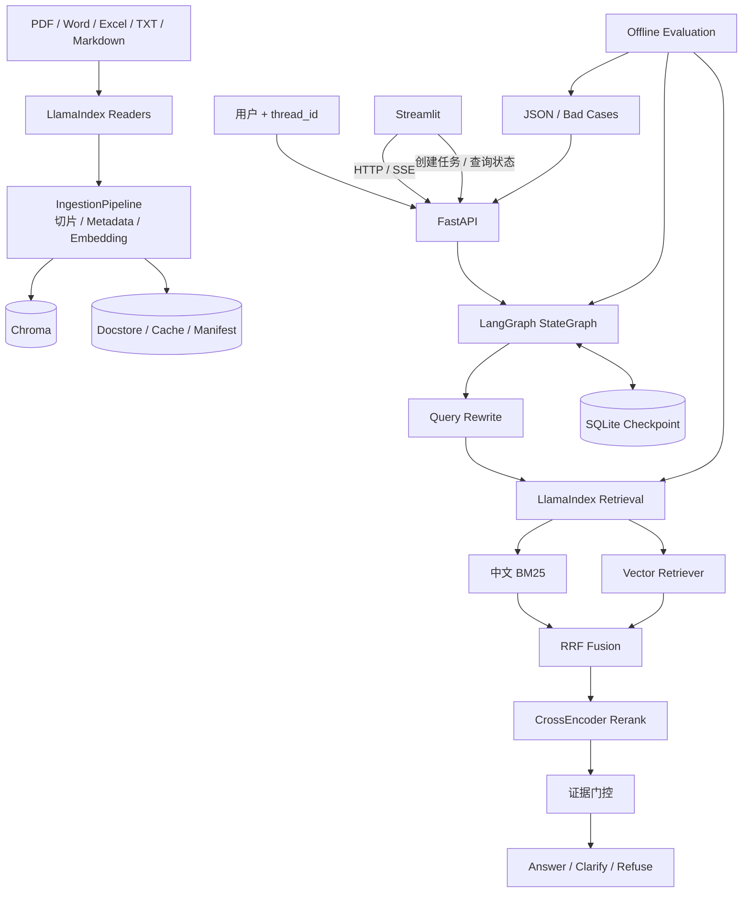

# 企业知识库 RAG Agent

一个可本地运行、可恢复会话、可观察检索过程并支持离线评测的企业知识库问答项目。项目以
LlamaIndex 负责数据摄取和检索，以 LangGraph 负责确定性问答流程，以 FastAPI/Streamlit
提供稳定接口和演示界面。

## 核心能力

- PDF、Word、Excel、TXT、Markdown 格式感知解析；
- 稳定 document/chunk ID、内容 hash、增量更新和重复跳过；
- 中文 BM25 + 向量召回 + RRF + CrossEncoder Rerank；
- Query Rewrite、证据门控、回答/澄清/拒答分支；
- SQLite checkpoint 多轮会话恢复；
- 引用来源、脱敏检索 Trace 和 SSE 生命周期事件；
- Streamlit 问答、知识库、调试和评测看板；
- 三组检索消融实验、Agent 指标与 Bad Case 报告。

## 架构与职责边界



- **LlamaIndex**：Reader、Node、IngestionPipeline、向量/BM25 检索、RRF、Rerank；
- **LangChain 1.x**：模型、Message、Tool 和结构化输出接口；
- **LangGraph 1.x**：有状态工作流、分支、checkpoint 和 thread 恢复；
- **项目代码**：业务 metadata、异常降级、证据阈值、API 契约和评测规则。

## 快速启动

要求 Python `>=3.10,<3.13`。

```bash
python -m venv .venv-v2
source .venv-v2/bin/activate
pip install -r requirements.txt
cp .env.example .env
```

配置一种 LLM：

```ini
# 云端示例
LLM_PROVIDER=siliconflow
SILICONFLOW_API_KEY=<your-api-key>
SILICONFLOW_MODEL_NAME=Qwen/Qwen2.5-7B-Instruct

# 或本地 Ollama
# LLM_PROVIDER=ollama
# OLLAMA_BASE_URL=http://localhost:11434
# OLLAMA_MODEL_NAME=qwen2.5:7b
```

Embedding 和 Reranker 优先读取 `models/` 下的本地目录；不存在时由对应模型库按配置名称
解析。离线运行前应提前下载模型。

启动 API：

```bash
source .venv-v2/bin/activate
python run_api.py
```

另开终端启动前端：

```bash
source .venv-v2/bin/activate
python run_frontend.py
```

- Streamlit：<http://127.0.0.1:8501>
- Swagger：<http://127.0.0.1:8000/docs>

## 文档摄取

网页可以直接上传，也可以使用命令行批量摄取：

```bash
python scripts/ingest_demo.py tests/sample_docs evaluation/sample_docs --category demo
```

重复摄取内容相同的文件会跳过 Embedding；同名文档内容变化时会更新变化来源并删除已经消失
的旧页/Sheet/段落组。

## 5～8 分钟演示建议

1. 在知识库页上传文档，展示任务状态、统计和稳定 `document_id`；
2. 在智能问答页问直接问题并展开引用，再用同一 thread 追问；
3. 刷新带 `?thread=...` 的页面，展示 SQLite checkpoint 恢复；
4. 在检索调试页讲解 Rewrite、Vector/BM25、RRF、Rerank 和证据门控；
5. 在评测看板比较三组实验并打开 Bad Case。

详细脚本见 `docs/PHASE6_STREAMLIT_DEMO_NOTES.md`。

## 离线评测

先摄取两组评测文档：

```bash
python scripts/ingest_demo.py tests/sample_docs evaluation/sample_docs --category demo
```

不调用 LLM，只运行三组检索消融实验：

```bash
python -m evaluation.run --mode retrieval --output reports/latest.json
```

运行完整检索 + Agent 评测：

```bash
python -m evaluation.run --all --output reports/latest.json
```

终端只打印各方案的 Recall/MRR/P95 和 Bad Case 数量。逐条结果写入
`reports/latest.json`。Streamlit 评测看板既可以加载最近报告，也可以通过 API 创建后台评测。
完整模式会调用 LLM，页面必须先勾选费用确认。

三组实验：

| Profile | Vector | BM25 | RRF | Rerank |
| --- | --- | --- | --- | --- |
| `vector_only` | 是 | 否 | 否 | 否 |
| `vector_rerank` | 是 | 否 | 否 | 是 |
| `hybrid_rerank` | 是 | 是 | 是 | 是 |

指标包括 Recall@K、MRR、来源命中率、引用正确率、关键词覆盖率、决策/拒答/澄清准确率，
以及平均/P95 检索和生成近似耗时。公式与分母见
`docs/PHASE7_EVALUATION_AND_DELIVERY_NOTES.md`。

## 自动测试

阶段 7 定向测试：

```bash
python -m pytest tests/evaluation tests/retrieval tests/frontend -q
```

稳定核心回归：

```bash
python -m pytest \
  tests/ingestion tests/retrieval tests/agent tests/api tests/frontend tests/evaluation \
  tests/test_config.py tests/test_api_smoke.py tests/test_phase1_contracts.py \
  tests/test_security_baseline.py -q
```

根目录中 `test_module*.py` 是早期手工集成脚本，其中部分会连接外部模型服务，不应当作纯
离线 CI 用例。执行完整 `python -m pytest -q` 前需保证模型和 LLM Provider 可用。

## 稳定 API

| 方法 | 路径 | 说明 |
| --- | --- | --- |
| GET | `/api/v1/system/health` | 进程存活检查 |
| GET | `/api/v1/system/ready` | 本地目录就绪检查 |
| POST | `/api/v1/documents/upload` | 上传并返回 `file_id/document_id` |
| GET | `/api/v1/documents/{file_id}/status` | 查询摄取任务 |
| GET | `/api/v1/documents` | 文档摘要列表 |
| DELETE | `/api/v1/documents/{document_id}` | 删除文档及 Chunks |
| POST | `/api/v1/qa/ask` | 同步问答、引用和可选 Trace |
| POST | `/api/v1/qa/stream` | SSE 生命周期事件 |
| GET | `/api/v1/sessions/{thread_id}/history` | 恢复会话历史 |
| DELETE | `/api/v1/sessions/{thread_id}` | 删除指定会话 |
| GET | `/api/v1/knowledge/stats` | 知识库统计 |
| GET | `/api/v1/evaluations/metadata` | 数据集、Profile 和指标公式 |
| POST | `/api/v1/evaluations/runs` | 创建后台评测任务 |
| GET | `/api/v1/evaluations/runs/{run_id}` | 查询评测状态 |
| GET | `/api/v1/evaluations/runs/{run_id}/report` | 读取指定任务报告 |
| GET | `/api/v1/evaluations/latest` | 读取最近成功报告 |

## 主要目录

```text
api/                    FastAPI 路由、Schema、响应转换
core/ingestion/         LlamaIndex 摄取与任务状态
core/retrieval/         原生 Retriever 组合和项目级降级边界
core/agent/             LangGraph 状态、节点、Tool、Rewrite
frontend/               Streamlit 与 HTTP 客户端
evaluation/             数据集、样例文档、指标和 CLI
reports/                本地评测报告（JSON 默认不提交）
tests/                  分层单元/契约测试
docs/                   各阶段设计和变更说明
```

## 已知限制

- SSE 当前发送生命周期和完整结果，不是逐 token 流；
- 本地模型首次加载耗时较长，且需要足够内存；
- 关键词覆盖率是确定性规则指标，不等同于语义正确性；
- 生成耗时是端到端耗时减检索耗时的近似值，包含 Rewrite/路由/门控；
- 当前数据集规模适合回归和面试演示，不代表生产业务的统计显著性；
- 每次页面评测会保留独立 JSON，当前尚未实现自动过期清理；
- Streamlit 删除文档尚无权限系统和二次确认；
- 单进程内有锁保护，多副本部署需要外部任务队列和分布式锁。

## 生产化路线

1. 引入租户、知识库和角色权限，并对上传/删除执行审计；
2. 将摄取任务迁移到 Celery/RQ/Kafka Worker，增加重试和死信队列；
3. 使用对象存储、托管向量库和 PostgreSQL checkpoint；
4. 增加 token streaming、限流、超时、熔断和 OpenTelemetry；
5. 从真实 Bad Case 持续扩充评测集，在 CI 中配置指标回退阈值；
6. 增加人工标注与可选 LLM-as-a-Judge，但保留确定性指标作为基线；
7. 对文档中的提示注入、恶意文件和敏感信息增加扫描与隔离。

## 变更文档

- `RAG_V2_MIGRATION_PLAN.md`
- `docs/PHASE1_MIGRATION_NOTES.md` ～ `docs/PHASE7_EVALUATION_AND_DELIVERY_NOTES.md`
