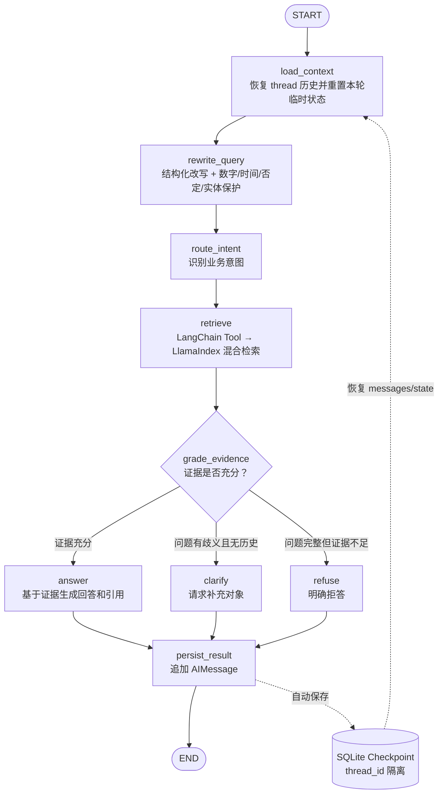

# 阶段 4：LangGraph Agent 与 SQLite Checkpoint 变更说明

## 1. 本阶段结果

旧的 LangChain Classic `create_retrieval_chain` 和进程内 `ConversationBufferWindowMemory`
已被显式 LangGraph 工作流替代：

```text
START
  ↓
load_context
  ↓
rewrite_query（结构化输出 + 约束一致性检查）
  ↓
route_intent
  ↓
retrieve（LangChain Tool → LlamaIndex 混合检索）
  ↓
grade_evidence
  ├─ answer
  ├─ clarify
  └─ refuse
       ↓
persist_result
  ↓
END
```

每次调用使用 `thread_id` 读取和写入 SQLite checkpoint。程序重启后，用同一个 thread 继续提问，
历史 HumanMessage/AIMessage 仍然存在。

### 1.1 Graph 流程图



图中实线表示本轮执行路径，虚线表示跨请求、跨进程的 checkpoint 读取与写入。

## 2. 框架职责边界

| 层 | 负责内容 | 不负责内容 |
| --- | --- | --- |
| LlamaIndex | 文档 Node、Chroma 向量召回、BM25、RRF、Rerank | 对话状态和业务决策 |
| LangChain 1.x | Chat Model、结构化输出、标准 Tool 和 Message | 主流程状态机 |
| LangGraph 1.x | 节点编排、条件路由、thread state、checkpoint | 检索算法 |
| 项目代码 | 改写保护、证据门控、异常降级、引用与 API 兼容 | 重复实现框架算法 |

阶段 3 的检索实现没有被复制进图。`retrieve` 节点只调用标准 Tool，Tool 再调用
`HybridRetrievalService`。

## 3. 主要文件

| 文件 | 作用 |
| --- | --- |
| `core/agent/state.py` | TypedDict Graph State 和消息 reducer |
| `core/agent/rewrite.py` | 结构化 Query Rewrite、触发规则和约束校验 |
| `core/agent/tools.py` | LlamaIndex 混合检索的 LangChain Tool 封装 |
| `core/agent/graph.py` | LangGraph 节点、条件边、SQLite checkpointer 和公开 Agent API |
| `core/rag_chain.py` | 保留旧 `RAGChain` 类名的兼容门面 |
| `scripts/chat_cli.py` | 支持 thread 与 debug trace 的人工验收入口 |
| `tests/agent/` | 改写、路由、降级和 checkpoint 专项测试 |

删除：

- `core/memory_manager.py`；
- `langchain-classic` 直接依赖；
- `create_history_aware_retriever`、`create_stuff_documents_chain`、
  `create_retrieval_chain` 主链。

## 4. Graph State

`RAGAgentState` 主要字段：

```text
messages                 完整对话消息，由 add_messages 合并
original_query           用户原问题
rewritten_query          可独立理解的改写问题
rewrite_applied          是否实际改写
rewrite_reason           改写/回退原因
protected_constraints    数字、时间、否定词、编号和显式实体
intent                   规则意图
retrieved_nodes          可序列化的检索证据
retrieval_trace          阶段 3 检索轨迹
insufficient_evidence    是否证据不足
decision                 answer / clarify / refuse
answer                   最终回复
citations                结构化引用
errors                   节点级错误与降级记录
```

状态中只保存普通字典、列表、标量和 LangChain Message，不保存 Chroma client、Retriever 或
LlamaIndex Node 实例。这保证 SQLite checkpoint 能跨进程恢复。

每轮开始时，`load_context` 都会重置检索、决策、引用和 errors 等临时字段，避免上一轮结果通过
checkpoint 泄漏到下一轮。

## 5. Query Rewrite 与一致性保护

### 5.1 什么时候改写

- 没有历史：不改写；
- 问题可以独立理解：不改写；
- 存在历史，且包含“这个、那个、它、刚才、那怎么”等指代：调用 LLM；
- 没有代词但属于“怎么申请、谁审批”等缺少明确主题的短问句：调用 LLM；
- “病假制度是什么”等已经带有明确业务主题的短问题：不改写。

这样可以减少模型调用和无意义改写。

### 5.2 结构化输出

通过 `llm.with_structured_output(RewriteResult)` 强制返回：

```json
{
  "rewritten_query": "员工加班应该怎么申请？",
  "rewrite_applied": true,
  "rewrite_reason": "把指代补全为员工加班"
}
```

### 5.3 确定性约束校验

在调用模型前从原问题提取：

- 数字及单位，例如 `15天`、`80%`；
- 明确时间，例如 `2026年10月`、`下周`；
- 否定词，例如 `不能`、`不得`、`没有`；
- 字母数字制度编号，例如 `HR-2024-01`；
- 书名号、引号或常见业务后缀标记的显式实体。

模型返回后由代码逐项检查。任何约束缺失都会放弃改写，恢复 `original_query`，并在
`rewrite_reason` 记录原因。改写失败或结构化解析失败也会重试后安全回退。

即使改写成功，检索仍使用：

```text
original_query + rewritten_query
```

分别建立向量/BM25 通道，再由阶段 3 的原生 RRF 融合，降低语义漂移风险。

## 6. Retrieval Tool

`create_retrieval_tool()` 使用 LangChain `StructuredTool` 包装
`HybridRetrievalService.retrieve()`，参数包括：

```text
original_query
alternate_queries
top_k
filter_dict
```

Tool 不实现检索算法。它只承担框架边界转换：

1. 调用阶段 3 服务；
2. 将 NodeWithScore 转成普通字典；
3. 将 NumPy、Path 等值归一成 checkpoint 可序列化类型；
4. 返回 nodes、trace 和 insufficient_evidence。

因此后续使用 `create_agent` 或增加其他 Tool 时，可以直接复用这个标准接口。

## 7. 证据决策

`grade_evidence` 只做确定性路由：

| 情况 | decision | 行为 |
| --- | --- | --- |
| 有通过阈值的检索证据 | `answer` | 调用回答 LLM，并输出引用 |
| 没证据，且问题缺少指代对象、无历史 | `clarify` | 请求用户补充制度/事项名称 |
| 没证据，但问题完整 | `refuse` | 明确说明知识库证据不足 |

`clarify` 和 `refuse` 不调用回答模型，避免模型在没有证据时凭常识编造。

回答模型调用失败会按 `AGENT_LLM_MAX_RETRIES` 重试；仍失败则返回安全文案，同时保留已经找到的
引用和 error trace。检索节点异常同样不会使整个图崩溃，而是转为证据不足路径。

## 8. SQLite Checkpoint

默认配置：

```dotenv
CHECKPOINT_DB_PATH=./data/agent_checkpoints.db
AGENT_HISTORY_WINDOW=5
AGENT_LLM_MAX_RETRIES=1
```

- `thread_id` 是会话隔离键；
- SQLite 保存完整消息与图状态；
- `AGENT_HISTORY_WINDOW` 只控制进入 LLM prompt 的最近轮数，不删除数据库历史；
- `clear_thread()` 使用 checkpointer 删除指定 thread，不影响其他会话；
- 数据库位于已被 `.gitignore` 排除的 `data/`，不会进入 Git。

`RAGChain.ask(question, session_id)` 会把旧 `session_id` 原样作为新 `thread_id`，因此现有 API
调用方无需立即修改。

## 9. 返回结果

阶段 4 Agent 内部完整返回：

```json
{
  "answer": "...",
  "sources": [],
  "citations": [],
  "intent": "操作指导",
  "decision": "answer",
  "original_query": "那怎么申请？",
  "rewritten_query": "员工加班应该怎么申请？",
  "rewrite_applied": true,
  "rewrite_reason": "把指代补全为员工加班",
  "trace": {},
  "errors": []
}
```

当前 `/api/v1/qa/ask` 仍返回旧 `answer/sources/intent` 契约。阶段 5 再正式扩展 HTTP schema，
避免在同一阶段同时修改图和前端协议。

## 10. 自动测试

阶段 4 专项测试：

```bash
.venv-v2/bin/python -m pytest tests/agent -q
```

覆盖：

- 独立问题不改写；
- 指代问题正确改写；
- 原问题与改写问题双路检索；
- 数字和否定约束丢失时回退；
- 歧义问题澄清；
- 无证据拒答且不调用回答 LLM；
- 检索异常记录与降级；
- 新 Agent 实例通过 SQLite 恢复同一 thread；
- 清理一个 thread 不影响其他 thread。

阶段 1—4 相关联合测试：

```bash
.venv-v2/bin/python -m pytest \
  tests/agent tests/retrieval tests/ingestion \
  tests/test_config.py tests/test_phase1_contracts.py \
  tests/test_api_smoke.py tests/test_security_baseline.py -q
```

## 11. 人工验收

```bash
.venv-v2/bin/python scripts/chat_cli.py --thread demo-001 --clear --debug
```

`--debug` 现在只在终端显示紧凑摘要：

```text
助手：……
--- 调试摘要 ---
决策：answer
原问题：那怎么申请？
改写问题：员工加班应该怎么申请？
是否改写：True
检索通道：
  - vector:0: 5 条，top=...，score=0.8123
  - bm25:0: 4 条，top=...，score=1.5372
融合结果：5 条，top=...，score=0.0325
重排结果：5 条，top=...，score=0.9744
引用：
  - [1] 员工制度.txt#2，score=0.9744
完整 trace：data/debug_traces/demo-001-20261011-....json
```

chunk 正文和完整 JSON 不再刷满终端，而是自动保存到 `data/debug_traces/`。该目录位于已被
Git 忽略的 `data/` 下。需要逐字段排查时直接打开提示的 JSON 文件。

只有明确需要把全部内容打印在终端时才使用：

```bash
.venv-v2/bin/python scripts/chat_cli.py \
  --thread demo-001 \
  --question "那怎么申请？" \
  --full-trace
```

自动测试同样建议保留 `-q`，失败时增加短调用栈，避免大量日志：

```bash
.venv-v2/bin/python -m pytest tests/agent -q --tb=short
```

按顺序输入：

1. `加班制度是什么？`
2. `那怎么申请？`
3. 输入 `exit`；
4. 重新运行同一条命令，但不要加 `--clear`；
5. 输入 `审批人是谁？`

检查：

- 第二问 `rewrite_applied=true`；
- `rewritten_query` 补全了“加班”；
- trace 同时有原问题和改写问题通道；
- answer 包含引用；
- 重启后同一 thread 仍能读取前两轮历史。

单次调试也可以运行：

```bash
.venv-v2/bin/python scripts/chat_cli.py \
  --thread demo-001 \
  --question "那怎么申请？" \
  --debug
```

## 12. 已知边界

- 当前意图识别仍是规则实现，只用于 trace，尚未路由不同业务 Tool；
- 显式约束保护是保守规则，不是完整中文 NER；
- SQLite 适合单机演示和中小规模部署，多实例服务应换 PostgreSQL 等共享 checkpointer；
- checkpoint 会保存检索证据文本，生产环境需配置数据保留和脱敏策略；
- HTTP 暂未暴露 decision、rewrite 和 trace，阶段 5 处理；
- `core/retriever.py` 的 LangChain Document 适配器仍为旧脚本保留，后续可清理。

## 13. 回滚范围

恢复：

```text
core/rag_chain.py
core/memory_manager.py
config/settings.py
.env.example
pyproject.toml
requirements.txt
uv.lock
README.md
```

删除：

```text
core/agent/
tests/agent/
scripts/chat_cli.py
docs/PHASE4_LANGGRAPH_AGENT_MIGRATION_NOTES.md
```

如需同时清除阶段 4 的本地会话数据，可删除 `data/agent_checkpoints.db`；该操作不会影响 Chroma。
