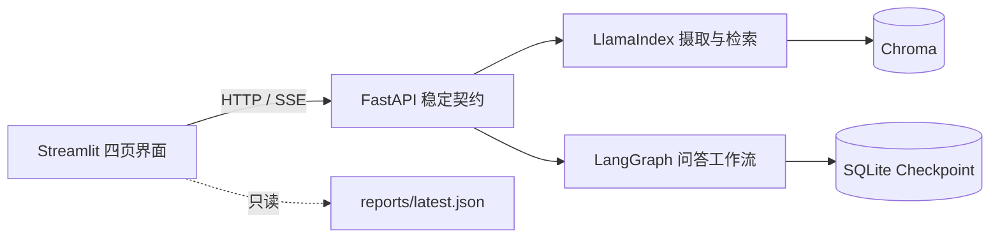
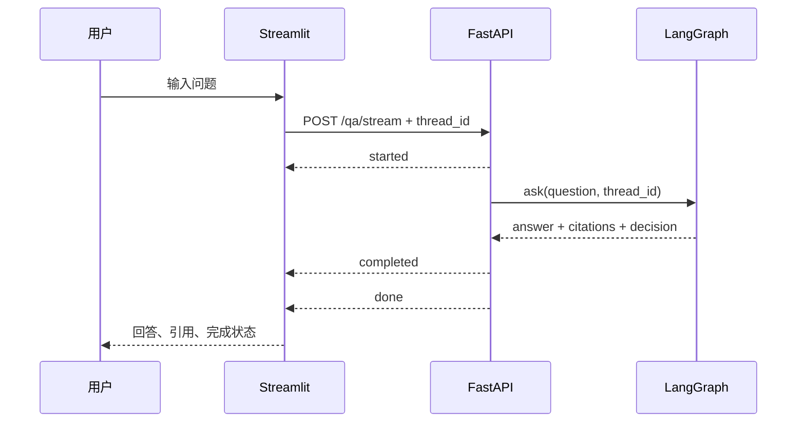

# 阶段 6：Streamlit 面试演示界面变更说明

## 1. 本阶段结果

阶段 6 增加了可在 5～8 分钟内演示完整 RAG 链路的 Streamlit 控制台，并保持前后端边界：



前端不直接 import `IngestionService`、`RAGChain` 或 LangGraph graph。这样 Streamlit 的每次
rerun 不会重新创建模型/向量库对象，也不会绕过阶段 5 的请求校验、trace 脱敏和错误处理。

## 2. 页面与演示重点

| 页面 | 能力 | 面试时建议说明 |
| --- | --- | --- |
| 智能问答 | SSE 状态、回答、引用、多轮 thread | 当前是生命周期流，未来可兼容新增 token 事件 |
| 知识库 | 上传、任务轮询、列表、删除、统计 | `file_id` 查任务，`document_id` 管业务文档 |
| 检索调试 | Query Rewrite、Vector/BM25、RRF、Rerank、耗时 | 前端只展示后端已脱敏 trace |
| 评测看板 | 指标、Bad Case、原始报告 | 阶段 6 只读报告，阶段 7 负责计算指标 |

### 2.1 智能问答流程



当前 `/qa/stream` 不是逐 token 输出，而是 `started → completed → done` 生命周期事件。
这是刻意保持的稳定契约：UI 能显示进度，未来后端新增 `token` 事件时，现有解析器仍可工作。

### 2.2 会话刷新恢复

`thread_id` 同时保存在：

1. Streamlit `session_state`，供当前页面 rerun 使用；
2. URL 查询参数 `?thread=...`，供浏览器刷新/复制链接使用；
3. LangGraph SQLite checkpoint，保存真正的 Human/AI 历史。

刷新后前端读取 URL 中的 ID，再调用：

```text
GET /api/v1/sessions/{thread_id}/history
```

所以浏览器内存不是会话真相来源。手工改为另一个已有 thread ID，也能恢复对应历史。

## 3. 新增文档列表契约

知识库页面刷新后必须能恢复文档列表，因此本阶段补充：

```text
GET /api/v1/documents
```

响应示例：

```json
{
  "total": 1,
  "documents": [
    {
      "document_id": "doc-...",
      "file_name": "员工制度.pdf",
      "category": "hr",
      "source_count": 12,
      "ingested_at": "2026-10-12T08:00:00+00:00",
      "updated_at": "2026-10-12T08:05:00+00:00"
    }
  ]
}
```

接口以 ingestion manifest 为业务真相来源，按更新时间倒序。返回模型主动排除了：

- `upload_path`：服务器本地绝对路径；
- `file_hash`：内部去重指纹；
- `source_ids`：内部引用集合，只返回数量；
- Chroma 内部结构和 docstore 状态。

## 4. 前端文件职责

| 文件 | 职责 |
| --- | --- |
| `frontend/app.py` | 四页布局、session state、URL thread 恢复和展示组件 |
| `frontend/api_client.py` | 普通 HTTP、上传、错误转换与 SSE 解析 |
| `frontend/reporting.py` | 安全读取阶段 7 的 JSON 报告、提取数字指标 |
| `run_frontend.py` | 使用当前 Python 环境启动 Streamlit |
| `tests/frontend/test_api_client.py` | 稳定路径、中文 SSE 和错误契约测试 |
| `tests/frontend/test_reporting.py` | 报告格式与指标提取测试 |

核心分支和状态处理均附有中文注释，重点解释“为什么通过 API”“为什么 thread 要写 URL”以及
“为什么评测页不在 UI 内计算指标”。

## 5. 启动方式

打开两个终端，均位于项目根目录并激活同一个虚拟环境：

```bash
# 终端 1
source .venv-v2/bin/activate
python run_api.py

# 终端 2
source .venv-v2/bin/activate
python run_frontend.py
```

访问：

- Streamlit：<http://127.0.0.1:8501>
- FastAPI 文档：<http://127.0.0.1:8000/docs>

前端默认 API 地址为 `http://127.0.0.1:8000`。需要改地址时：

```bash
RAG_API_BASE_URL=http://127.0.0.1:9000 python run_frontend.py
```

## 6. 5～8 分钟演示脚本

1. **知识库（约 1 分钟）**：展示统计，上传 `tests/sample_docs/test.txt`，说明后台任务和
   去重，刷新状态直到 succeeded。
2. **智能问答（约 2 分钟）**：问一个直接事实问题，展开引用；再问“那需要什么材料？”
   展示同一 thread 的多轮理解。
3. **刷新恢复（约 30 秒）**：复制 URL 中 thread，刷新页面，说明历史来自 SQLite
   checkpoint 而不是浏览器变量。
4. **检索调试（约 2 分钟）**：用同一个追问执行 Trace，依次讲 Query Rewrite、向量/BM25
   双路召回、RRF 融合、CrossEncoder Rerank 和证据阈值。
5. **评测看板（约 1 分钟）**：说明指标和 Bad Case 不是“看起来答对”，而是离线数据驱动；
   阶段 7 生成报告后本页自动读取。

## 7. 自动测试

阶段 6 定向测试：

```bash
python -m pytest tests/api/test_documents_contract.py tests/frontend -q
```

完整回归：

```bash
python -m pytest -q
```

浏览器冒烟测试应至少确认：

- 四个导航页面都能打开；
- API 在线/离线状态可理解；
- 无知识库和无报告时有明确空状态；
- 页面没有 Python 异常栈；
- URL 带 `thread` 参数，刷新后仍是同一个 ID。

## 8. 失败与降级行为

- API 离线：侧栏显示红色“API 离线”，页面仍可打开，不打印异常栈；
- SSE 中断：回答区显示安全中文错误，不写入一条伪造 assistant 消息；
- 上传失败：保留上一次成功任务，不自动无限轮询；
- 报告不存在：展示已有评测问题和阶段说明，不伪造 Recall/MRR；
- Rerank 降级：调试页展示 `rerank_applied=false` 和后端脱敏错误类型。

知识库任务采用手动“刷新任务状态”，避免 Streamlit `sleep` 阻塞整个会话，也避免演示终端
被轮询日志刷屏。

## 9. 阶段边界与已知限制

本阶段已完成 UI 和展示契约，但不提前实现阶段 7：

- 现有评测脚本尚未支持 `--all --output reports/latest.json`；
- 评测数据仍只有最小 retrieval cases；
- 尚无对比实验、P95 延迟、引用正确率和拒答准确率；
- SSE 尚未逐 token 输出；
- 删除文档是直接操作，生产界面应再增加二次确认和权限控制。

这些内容将在阶段 7 的评测、Bad Case 与交付文档中处理。

## 10. 回滚范围

若需要只回滚阶段 6，删除 `frontend/`、`run_frontend.py`、本说明和 `tests/frontend/`，并回退
文档列表相关的 `DocumentRecord`、Schema、路由与契约测试即可。阶段 1～5 的摄取、检索、
LangGraph 和稳定问答 API 不受影响。
