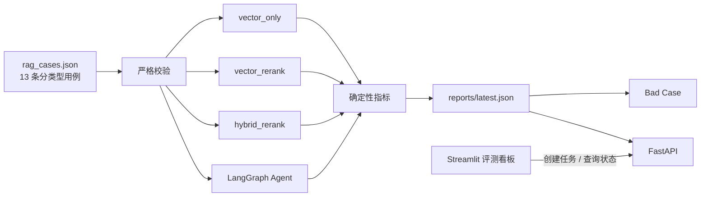

# 阶段 7：评测、Bad Case 与交付文档变更说明

## 1. 本阶段结果

阶段 7 把“看起来能回答”变成可重复、可比较、可定位失败原因的离线评测：



评测计算集中在 `evaluation/`，Streamlit 只通过 FastAPI 创建后台任务和读取报告，不直接加载
模型。真实运行与指标单测也完全分离：单测注入 Fake Retriever/Agent，不需要网络；CLI 或
API 后台任务才创建真实模型、Chroma 和 LangGraph。

## 2. 评测集

主数据集为 `evaluation/rag_cases.json`，当前 13 条，覆盖：

| 类型 | 目的 | 示例 |
| --- | --- | --- |
| `direct` | 直接事实 | 全年事假上限 |
| `semantic_rewrite` | 同义表达 | 因个人私事离岗的累计上限 |
| `numbered_term` | 条款编号/专有词 | 第四条、试用期员工 |
| `table` | Markdown 表格 | 北京住宿标准、高铁席别 |
| `multi_turn` | 历史指代 | “那试用期员工呢？” |
| `similar_policy` | 易混制度 | 病假工资与事假工资 |
| `no_answer` | 无证据拒答 | 量子纠错、海外搬迁补贴 |
| `ambiguous` | 信息不足澄清 | “这个要怎么办？” |

表格用例的稳定语料为 `evaluation/sample_docs/expense_policy.md`。考勤用例继续使用
`tests/sample_docs/test.txt`，避免依赖个人上传文件。

每条回答型用例必须声明：

- `relevant_files`：正确来源文件；
- `expected_keywords`：答案必须覆盖的确定性事实；
- `expected_decision`：`answer/clarify/refuse`；
- `history`：仅多轮用例提供的前置问题。

加载时会检查空数组、重复 ID、非法类型、非法决策以及回答型用例缺少来源/关键词。校验失败
发生在模型运行前，避免昂贵评测跑到一半才发现数据错误。

## 3. 三组消融实验边界

| Profile | 原问题向量 | 改写 Query | BM25 | RRF | Rerank |
| --- | --- | --- | --- | --- | --- |
| `vector_only` | 是 | 否 | 否 | 否 | 否 |
| `vector_rerank` | 是 | 否 | 否 | 否 | 是 |
| `hybrid_rerank` | 是 | 可选 | 是 | 是 | 是 |

`HybridRetrievalService.retrieve()` 新增 `profile` 参数，默认值为 `hybrid_rerank`，所以 API、
Agent 和旧调用方行为不变。两个向量基线刻意只使用原问题，避免 Query Rewrite 的收益被错误
归因给向量或 Rerank。

Profile 只控制项目级编排开关，底层算法仍由 LlamaIndex 原生组件执行：

- Vector：`VectorIndexRetriever`；
- BM25：`BM25Retriever` + 项目中文 tokenizer；
- RRF：`QueryFusionRetriever` 的原生 RRF；
- Rerank：`SentenceTransformerRerank`。

## 4. 指标定义

### 4.1 检索指标

无答案/澄清用例没有正确来源，不参与排名指标。

```text
Recall@K = Top-K 中至少出现一个正确来源的用例数 / 有正确来源的用例数

MRR = mean(1 / 第一个正确来源的排名)
      未命中时该用例贡献 0

来源命中率 = 实际命中的期望来源数 / 全部期望来源数
```

当前大部分用例只有一个正确来源，因此 Recall@K 与来源命中率可能相同；设计上仍分别保留，
后续一个问题需要多份制度联合回答时，来源命中率会体现遗漏的来源。

延迟使用 `time.perf_counter()`：

- 平均检索耗时：所有正例的算术平均；
- P95 检索耗时：nearest-rank，第 `ceil(0.95 × N)` 个真实观测值，不做小样本插值。

### 4.2 Agent 指标

```text
决策准确率 = decision 与 expected_decision 一致的用例数 / 全部用例数

引用正确率 = 每个回答型用例中，来自 relevant_files 的引用数 / 该用例引用总数
             回答型用例无引用时记 0，再对回答型用例取平均

关键词覆盖率 = 答案命中的 expected_keywords 数 / expected_keywords 总数
               再对回答型用例取平均

拒答准确率 = 正确输出 refuse 的无答案用例数 / expected_decision=refuse 的用例数

澄清准确率 = 正确输出 clarify 的歧义用例数 / expected_decision=clarify 的用例数
```

关键词比较会统一小写并删除空白，但不做模糊语义判断。这样结果可重复、无额外调用成本；它
不能替代人工判断或 LLM-as-a-Judge，限制会在报告解释中明确说明。

`generation_ms = 端到端耗时 - trace.elapsed_ms`，它实际包含 Rewrite、意图路由、证据门控
和回答节点，是“非检索阶段耗时”的近似值，不是底层模型首 Token 延迟。

## 5. Bad Case 规则

检索 Bad Case：

- `expected_source_not_retrieved`：Top-K 没有任何期望来源。
- `reranker_degraded`：该 Profile 要求 Rerank，但本次实际未应用（例如模型加载失败）。

Agent Bad Case：

- `decision_mismatch`：回答/澄清/拒答分支错误；
- `keyword_missing`：至少一个期望事实未出现；
- `citation_source_mismatch`：没有引用正确来源；
- `unexpected_citation`：拒答或澄清结果仍附带引用。

报告保留失败阶段、case 类型、问题、期望/实际来源、排名、延迟和原因，但不保存 API Key、
本地绝对路径、模型异常正文或完整检索 chunk。

## 6. 报告结构

`reports/latest.json` 的稳定顶层：

```text
schema_version / generated_at / dataset / cases / top_k
primary_profile
experiments
  ├─ vector_only
  ├─ vector_rerank
  └─ hybrid_rerank
qa
bad_cases
details
常用扁平指标（Recall、MRR、Citation、Keyword、Latency...）
```

`hybrid_rerank` 是主实验，其常用指标复制到顶层，方便 Streamlit 和未来 CI 阈值读取。详细
实验仍保存在 `experiments`，不会因扁平展示而丢失。每组实验额外返回
`degraded_cases`；只要 Reranker 没有真正执行，就不会把降级后的结果误当成完整实验结果。

报告使用临时文件加原子替换写入；评测中断不会覆盖上一次完整报告。JSON 默认被 `.gitignore`
排除，避免业务问题文本误提交到仓库。

## 7. 运行方式

### 7.1 准备数据

```bash
source .venv-v2/bin/activate
python scripts/ingest_demo.py \
  tests/sample_docs \
  evaluation/sample_docs \
  --category demo
```

`ingest_demo.py` 现在支持多个文件/目录，按解析后的绝对路径去重，并忽略不支持的格式。

### 7.2 只测检索（不调用 LLM）

```bash
python -m evaluation.run \
  --mode retrieval \
  --output reports/latest.json
```

### 7.3 完整评测

```bash
python -m evaluation.run --all --output reports/latest.json
```

`--all` 等价于 `--mode all`。每条 Agent 用例使用临时 thread，多轮问题先依次写入 history，
最终问题完成后清理 checkpoint。

默认终端只显示：

```text
评测集、用例数、Top-K
三组实验的 Recall / MRR / P95
Agent Decision / Citation / Keyword / Refusal
Bad Case 数和报告路径
```

只有显式增加 `--print-json` 才打印完整 JSON，避免终端内容过多无法判断。

## 8. Streamlit 看板

评测页现在支持：

1. 选择检索/完整评测、Top-K 和知识库分类；
2. 完整模式的 LLM 费用确认；
3. 后台任务状态刷新与最近报告恢复；
4. 指标公式、含义、范围和统计分母；
5. 主链常用指标卡、三组消融实验、Bad Case 和原始报告。

页面不在 Streamlit 进程中计算指标，避免 rerun 重复调用模型；API 与 CLI 最终都复用
`execute_evaluation()`。

## 9. 自动测试

```bash
python -m pytest tests/evaluation tests/retrieval tests/frontend -q
```

测试重点：

- Profile 确实关闭对应组件；
- Recall/MRR/来源命中率分母正确；
- 引用、关键词、拒答和澄清指标正确；
- Bad Case 同时保留 retrieval/qa 阶段；
- 重复 case ID 在模型运行前失败；
- 前端能把嵌套实验转换为表格。

## 10. 主要文件

| 文件 | 作用 |
| --- | --- |
| `evaluation/models.py` | 数据模型和严格校验 |
| `evaluation/runner.py` | 指标、P95、Bad Case 和报告组装 |
| `evaluation/run.py` | 真实运行、紧凑终端摘要和原子写报告 |
| `evaluation/rag_cases.json` | 13 条分类型用例 |
| `evaluation/sample_docs/expense_policy.md` | 表格检索稳定语料 |
| `core/retrieval/hybrid.py` | 三组 Profile 的原生组件开关 |
| `frontend/reporting.py` | 报告指标和实验表格转换 |
| `frontend/app.py` | 评测看板展示 |
| `tests/evaluation/test_runner.py` | 无网络指标单测 |

关键分支均补充中文注释，重点解释消融边界、指标分母、P95 算法、临时 thread 清理、报告
原子写入和为什么不在 Streamlit 内运行评测。

## 11. 已知限制与下一步

- 13 条数据用于演示和回归，不具备统计显著性；
- 关键词覆盖无法判断同义表达或事实矛盾；
- 没有计算模型首 Token/逐 Token 延迟；
- 真实 `--all` 会调用配置的 LLM，产生时间和可能的 API 费用；
- 当前没有在 CI 中设置最低指标阈值，因为首份真实基线需要先由项目负责人确认；
- 后续应从线上匿名 Bad Case 扩充数据，并增加人工标注版本和可选 LLM Judge。

## 12. 回滚范围

只回滚阶段 7 时，删除新的 evaluation models/runner/data、报告目录和本说明，恢复旧
`evaluation/run.py`，移除 retrieval `profile` 参数与前端消融表即可。生产默认 Profile 一直是
`hybrid_rerank`，阶段 1～6 的问答行为不依赖评测报告。
