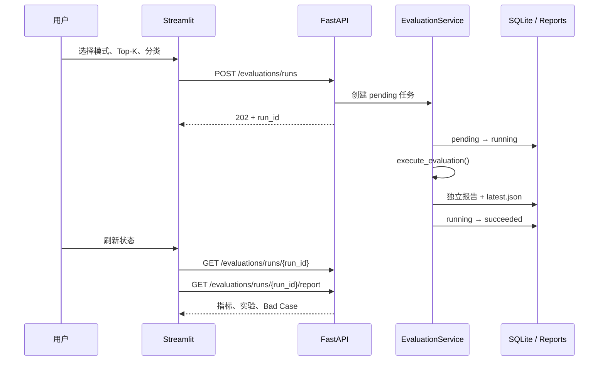

# 阶段 7 补充：页面评测操作与指标说明

## 1. 功能结果

评测看板现在可以直接：

1. 查看评测集规模、场景类型和检索方案；
2. 阅读每个指标的公式、含义、范围和统计分母；
3. 选择检索评测或完整 Agent 评测；
4. 配置 Top-K 和知识库分类；
5. 创建后台任务并刷新任务状态；
6. 加载当前任务或最近一次成功报告；
7. 查看指标卡、消融实验、降级数和 Bad Case。

## 2. 调用流程



Streamlit 不直接 import Retriever、RAGChain 或指标函数。页面操作和 CLI 都调用同一个
`execute_evaluation()`，不会产生两套结果。

## 3. API

| 方法 | 路径 | 说明 |
| --- | --- | --- |
| GET | `/api/v1/evaluations/metadata` | 用例数、场景、Profile、指标公式 |
| POST | `/api/v1/evaluations/runs` | 创建后台任务 |
| GET | `/api/v1/evaluations/runs/{run_id}` | 查询 pending/running/succeeded/failed |
| GET | `/api/v1/evaluations/runs/{run_id}/report` | 读取指定报告 |
| GET | `/api/v1/evaluations/latest` | 读取最近成功报告 |

完整评测必须提交：

```json
{
  "mode": "all",
  "top_k": 5,
  "category": "demo",
  "confirm_llm_cost": true
}
```

没有确认时返回 400。已有任务运行时返回 409，防止重复点击同时加载多套模型。

## 4. 状态与恢复

- 状态保存在 `data/evaluation/jobs.db`，元数据接口会返回当前活动任务，页面刷新或重新连接时可恢复 run_id；
- 每次成功生成 `reports/{run_id}.json`，同时更新 `reports/latest.json`；
- 写报告采用临时文件加原子替换；
- API 重启后，遗留 pending/running 任务会标记为 `ProcessInterrupted`，不会永久阻塞；
- 页面只显示统一失败文案，具体异常类型保存在 SQLite，完整堆栈进入 API 日志。

当前一次只运行一个评测任务。报告尚无自动过期清理，生产环境应增加保留周期。

## 5. 指标说明来源

指标公式集中在 `evaluation/metrics.py`，由 metadata API 返回。页面没有复制公式，因此修改
指标定义时只维护一处。

页面展示 13 项说明，包括：Recall@K、MRR、来源命中率、决策/引用/关键词/拒答/澄清准确率、
平均/P95 检索耗时、平均/P95 生成耗时和降级用例数。

## 6. 安全与费用边界

- 检索评测不调用 LLM；
- 完整评测必须在页面勾选费用确认，API 仍会二次校验；
- 客户端不能指定数据集路径或报告路径；
- `report_name` 读取前再次收敛为文件名，避免路径越界；
- 报告不保存 API Key、异常正文或完整检索 Chunk；
- 评测任务与业务会话继续隔离，临时 thread 完成后清理。

## 7. 测试

```bash
python -m pytest \
  tests/evaluation \
  tests/api/test_evaluations_contract.py \
  tests/frontend -q
```

覆盖任务持久化、并发拒绝、中断恢复、费用确认、报告读取、指标公式 API 和前端客户端契约。
